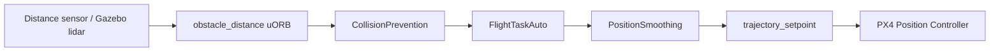

# PX4 Autonomous Collision Prevention

An experimental extension of PX4 v1.17 that adds collision-prevention behavior to Auto/Mission flight.

The original PX4 Collision Prevention flow is mainly designed for Manual Position mode. This project reuses the existing obstacle map and sensor freshness logic to add a safety layer for autonomous flight.

> Status: Experimental. Core Collision Prevention tests pass. SITL fault-injection support is available. Real-flight validation has not been completed.

## Project scope

This project can:

- limit autonomous horizontal velocity near obstacles;
- calculate safe velocity using obstacle distance, vehicle velocity, jerk and braking acceleration;
- brake and force zero velocity when collision risk becomes critical;
- stop the vehicle and request `AUTO_LOITER` when obstacle data is lost;
- preserve the original Manual Collision Prevention behavior;
- ignore Auto Collision Prevention intervention during RTL;
- simulate Gazebo lidar failure in SITL.

This is a collision-prevention safety layer, not a complete obstacle-avoidance planner. It does not create a new path or automatically choose left/right around an obstacle. The current implementation slows down or stops the vehicle when the mission direction is blocked.

## Architecture



The safety layer operates before `trajectory_setpoint` is sent to the normal PX4 position controller. It does not modify `mc_pos_control`, `mc_att_control`, `mc_rate_control`, `control_allocator`, or EKF2.

## Modified areas

| Area | Location | Purpose |
|---|---|---|
| Collision Prevention core | `src/lib/collision_prevention/` | Obstacle map and safe-velocity calculation |
| Auto flight task | `src/modules/flight_mode_manager/tasks/Auto/` | Velocity, braking and mode constraints |
| SITL bridge | `src/modules/simulation/gz_bridge/` | Gazebo lidar fault injection |
| Tests | `CollisionPreventionTest.cpp` | Safe velocity and braking tests |
| Documentation | `docs/collision_prevention_safety_layer_report.md` | Detailed design report |

## Important parameters

| Parameter | Default | Description |
|---|---:|---|
| `CP_AUTO_EN` | `0` | Enable Collision Prevention in Auto/Mission |
| `CP_DIST` | PX4 default | Minimum distance from obstacles |
| `CP_MAX_ANGLE` | `10 deg` | Normal autonomous acceleration limit |
| `CP_BRAKE_ANGLE` | `30 deg` | Braking acceleration limit |
| `CP_STOP_VEL` | `0.2 m/s` | Stop-confirmation velocity threshold |
| `SIM_GZ_LIDAR_F` | `0` | Stop publishing Gazebo lidar data |

## SITL quick start

```bash
make px4_sitl gz_x500_lidar_2d
```

```bash
param set CP_AUTO_EN 1
param set CP_DIST 2
param set CP_MAX_ANGLE 10
param set CP_BRAKE_ANGLE 30
```

To simulate lidar failure:

```bash
param set SIM_GZ_LIDAR_F 1
```

To restore lidar data:

```bash
param set SIM_GZ_LIDAR_F 0
```

Useful topics:

```bash
listener vehicle_status
listener trajectory_setpoint
listener obstacle_distance
listener mavlink_log
```

## Test status

```text
functional-CollisionPrevention: 27 tests passed
unit-ObstacleMath: 6 tests passed
```

Auto/Mission integration tests and real hardware validation are still required.

## Known limitations

- No automatic route selection around obstacles.
- Sensor FOV and unknown-space handling require further validation.
- Auto/Mission mode-transition tests are incomplete.
- Mode command acknowledgement and retry behavior require further testing.
- This project is not a certified flight-safety system.

## Project base and attribution

This project is based on PX4 Autopilot v1.17, branch `release/1.17`, base commit `d6f12ad1c4`.
Detailed implementation notes are available in [`docs/collision_prevention_safety_layer_report.md`](docs/collision_prevention_safety_layer_report.md).

This repository retains the original PX4 license and copyright notices. PX4 is licensed under the BSD 3-Clause License; see [`LICENSE`](LICENSE).

[](https://github.com/PX4/PX4-Autopilot/releases) [](https://zenodo.org/badge/latestdoi/22634/PX4/PX4-Autopilot)

[](https://github.com/PX4/PX4-Autopilot/actions/workflows/build_all_targets.yml) [](https://github.com/PX4/PX4-Autopilot/actions?query=workflow%3A%22SITL+Tests%22)

[](https://discord.gg/dronecode)

This repository holds the [PX4](http://px4.io) flight control solution for drones, with the main applications located in the [src/modules](https://github.com/PX4/PX4-Autopilot/tree/main/src/modules) directory. It also contains the PX4 Drone Middleware Platform, which provides drivers and middleware to run drones.

PX4 is highly portable, OS-independent and supports Linux, NuttX and MacOS out of the box.

* Official Website: http://px4.io (License: BSD 3-clause, [LICENSE](https://github.com/PX4/PX4-Autopilot/blob/main/LICENSE))
* [Supported airframes](https://docs.px4.io/main/en/airframes/airframe_reference.html) ([portfolio](https://px4.io/ecosystem/commercial-systems/)):
  * [Multicopters](https://docs.px4.io/main/en/frames_multicopter/)
  * [Fixed wing](https://docs.px4.io/main/en/frames_plane/)
  * [VTOL](https://docs.px4.io/main/en/frames_vtol/)
  * [Autogyro](https://docs.px4.io/main/en/frames_autogyro/)
  * [Rover](https://docs.px4.io/main/en/frames_rover/)
  * many more experimental types (Blimps, Boats, Submarines, High Altitude Balloons, Spacecraft, etc)
* Releases: [Downloads](https://github.com/PX4/PX4-Autopilot/releases)

## Releases

Release notes and supporting information for PX4 releases can be found on the [Developer Guide](https://docs.px4.io/main/en/releases/).

## Building a PX4 based drone, rover, boat or robot

The [PX4 User Guide](https://docs.px4.io/main/en/) explains how to assemble [supported vehicles](https://docs.px4.io/main/en/airframes/airframe_reference.html) and fly drones with PX4. See the [forum and chat](https://docs.px4.io/main/en/#getting-help) if you need help!


## Changing Code and Contributing

This [Developer Guide](https://docs.px4.io/main/en/development/development.html) is for software developers who want to modify the flight stack and middleware (e.g. to add new flight modes), hardware integrators who want to support new flight controller boards and peripherals, and anyone who wants to get PX4 working on a new (unsupported) airframe/vehicle.

Developers should read the [Guide for Contributions](https://docs.px4.io/main/en/contribute/).
See the [forum and chat](https://docs.px4.io/main/en/#getting-help) if you need help!


## Weekly Dev Call

The PX4 Dev Team syncs up on a [weekly dev call](https://docs.px4.io/main/en/contribute/).

> **Note** The dev call is open to all interested developers (not just the core dev team). This is a great opportunity to meet the team and contribute to the ongoing development of the platform. It includes a QA session for newcomers. All regular calls are listed in the [Dronecode calendar](https://www.dronecode.org/calendar/).


## Maintenance Team

See the latest list of maintainers on [MAINTAINERS](MAINTAINERS.md) file at the root of the project.

For the latest stats on contributors please see the latest stats for the Dronecode ecosystem in our project dashboard under [LFX Insights](https://insights.lfx.linuxfoundation.org/foundation/dronecode). For information on how to update your profile and affiliations please see the following support link on how to [Complete Your LFX Profile](https://docs.linuxfoundation.org/lfx/my-profile/complete-your-lfx-profile). Dronecode publishes a yearly snapshot of contributions and achievements on its [website under the Reports section](https://dronecode.org).

## Supported Hardware

For the most up to date information, please visit [PX4 User Guide > Autopilot Hardware](https://docs.px4.io/main/en/flight_controller/).

## Project Governance

The PX4 Autopilot project including all of its trademarks is hosted under [Dronecode](https://www.dronecode.org/), part of the Linux Foundation.

<a href="https://www.dronecode.org/" style="padding:20px" ></a>
<div style="padding:10px">&nbsp;</div>
