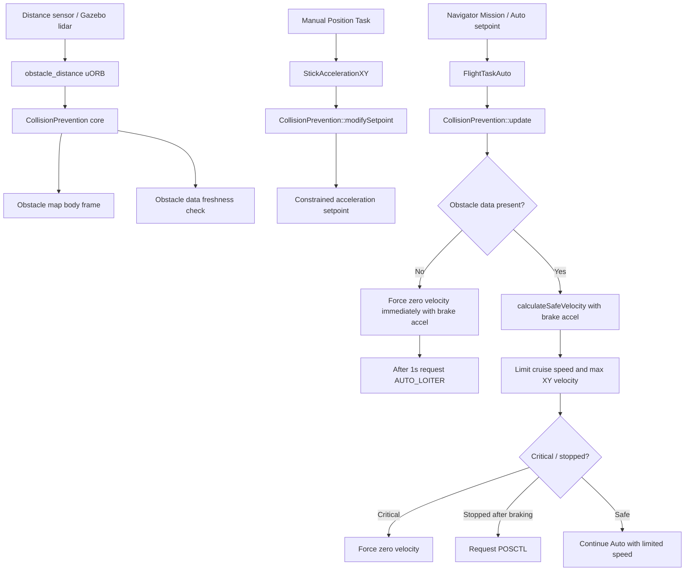
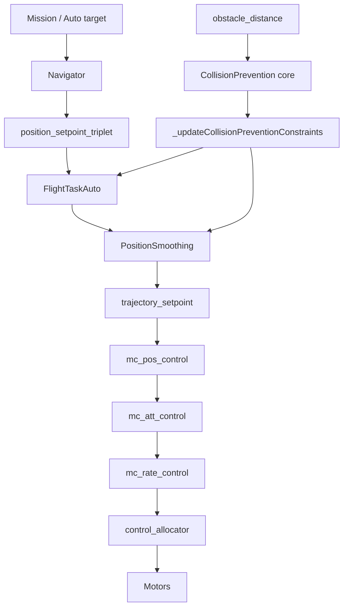
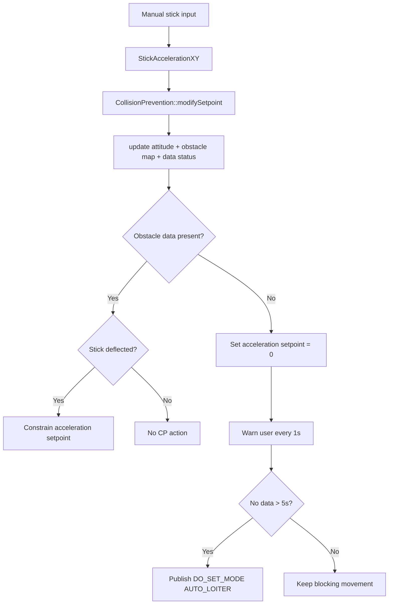
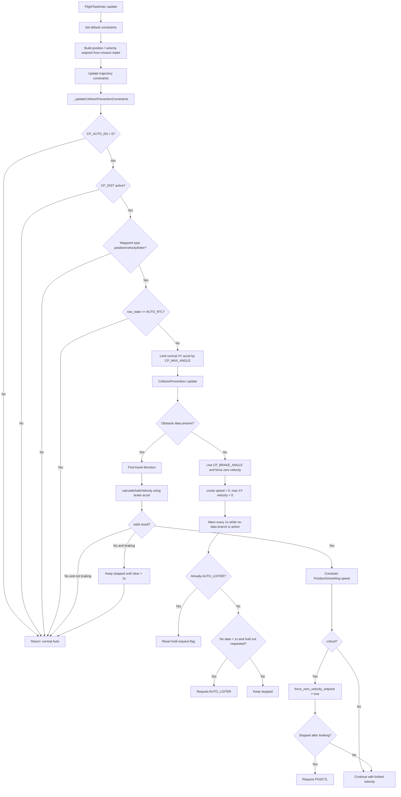

# Collision Prevention Safety Layer Report

## 1. Muc tieu

Mo rong Collision Prevention (CP) cua PX4 tu logic ho tro Manual sang mot lop an toan cho bay Auto/Mission, voi nguyen tac:

- Khong lap ke hoach duong di moi.
- Khong tu re trai/phai de tranh vat can.
- Chi gioi han toc do, ep dung, hoac chuyen mode an toan khi can.
- Khong can thiep tang dieu khien thap nhu `mc_att_control`, `mc_rate_control`, `control_allocator`.
- Su dung lai obstacle map va stale-data logic co san trong `CollisionPrevention`.

Pham vi hien tai:

- Manual: giu flow CP goc, stick acceleration bi gioi han theo obstacle.
- Auto/Mission: gioi han velocity setpoint qua `FlightTaskAuto` va `PositionSmoothing`.
- CP Auto active: gioi han gia toc ngang bang `CP_MAX_ANGLE` khi bay binh thuong va `CP_BRAKE_ANGLE` khi phanh/no-data.
- Sensor loss:
  - Manual: block movement, sau 5s request Loiter/Hold.
  - Auto/Mission: dung ngay, sau 1s request Hold.
- RTL: da co guard de khong bi CP Auto can thiep.
- SITL: co tham so fault injection de tat obstacle distance tu Gazebo lidar trong luc bay.

## 2. Kien truc tong the



## 3. Vi Tri CP Trong Kien Truc PX4

Tai lieu tham khao `PX4_v1.17_multicopter_control_architecture.md` mo ta multicopter PX4 theo chuoi cascade:

```text
RC / Mission / Offboard
        |
        v
Commander / Mode Selection
        |
        v
Navigator + Flight Mode Manager + Flight Tasks
        |
        | trajectory_setpoint
        v
mc_pos_control
        |
        | vehicle_attitude_setpoint
        v
mc_att_control
        |
        | vehicle_rates_setpoint
        v
mc_rate_control
        |
        | vehicle_torque_setpoint + vehicle_thrust_setpoint
        v
control_allocator
        |
        v
actuator_motors / ESC / Motor
```

Phan CP mo rong trong bao cao nay duoc dat o lop **Setpoint Generation**, truoc khi `trajectory_setpoint` duoc dua xuong `mc_pos_control`.



Diem can thiep cu the:

- `CollisionPrevention` core doc `obstacle_distance`, tao obstacle map va kiem tra stale data.
- `FlightTaskAuto::_updateCollisionPreventionConstraints(...)` goi CP core de tinh safe velocity.
- `PositionSmoothing` bi gioi han bang `setCruiseSpeed(...)`, `setMaxVelocityXY(...)`, va `setMaxAccelerationXY(...)`.
- Khi can dung khan cap, `force_zero_velocity_setpoint` duoc set truoc khi `PositionSmoothing::generateSetpoints(...)` tao `trajectory_setpoint`.
- Khi can chuyen mode an toan, `FlightTaskAuto` publish `vehicle_command` de request `AUTO_LOITER` hoac `POSCTL`.

Nhung tang khong can thiep:

- Khong sua `mc_pos_control`: position controller van nhan `trajectory_setpoint` nhu binh thuong.
- Khong sua `mc_att_control`: attitude controller van chuyen attitude setpoint sang rate setpoint nhu PX4 goc.
- Khong sua `mc_rate_control`: rate loop va PID rate van giu nguyen.
- Khong sua `control_allocator`: phan bo thrust/torque ra motor van giu nguyen.
- Khong sua estimator/EKF2: CP dung state va obstacle data da co, khong thay doi state estimation.

Vi vay co the hieu CP Auto la mot **safety filter tren setpoint**, khong phai mot controller moi. CP khong tu tinh motor output, khong dieu khien goc nghien truc tiep, va khong lap duong tranh vat can. No chi lam cac viec:

- gioi han speed/acceleration input cua trajectory smoothing;
- ep zero velocity khi critical/no-data;
- request mode an toan khi dieu kien safety bi vi pham.

## 4. Manual CP Flow

Source chinh:

- `src/lib/collision_prevention/CollisionPrevention.cpp`
- `src/lib/collision_prevention/CollisionPrevention.hpp`

Flow Manual hien tai:



Tac dung:

- Neu co data obstacle: CP gioi han acceleration theo huong stick.
- Neu khong co data: Manual khong cho di chuyen, canh bao user, va sau 5s request Hold.
- Manual van dung ham `modifySetpoint()`, nen han che rui ro pha flow goc cua PX4.

## 5. Auto/Mission CP Flow

Source chinh:

- `src/modules/flight_mode_manager/tasks/Auto/FlightTaskAuto.cpp`
- `src/modules/flight_mode_manager/tasks/Auto/FlightTaskAuto.hpp`
- `src/modules/flight_mode_manager/tasks/Auto/CMakeLists.txt`
- `src/lib/collision_prevention/CollisionPrevention.cpp`
- `src/lib/collision_prevention/CollisionPrevention.hpp`

Flow Auto/Mission:



Tac dung:

- CP Auto chi chay khi `CP_AUTO_EN > 0`, `CP_DIST` active, waypoint type phu hop, va khong phai RTL.
- Khi CP Auto active, horizontal acceleration limit duoc ha theo `CP_MAX_ANGLE` luc bay binh thuong.
- Khi no-data, braking, hoac critical, horizontal acceleration limit duoc nang theo `CP_BRAKE_ANGLE` de phanh manh hon.
- Khi mat distance data, Mission bi ep dung ngay lap tuc.
- Sau khi mat data lien tuc hon 1s, CP request `AUTO_LOITER`.
- Neu user chuyen lai Mission trong khi data van mat, UAV van bi dung va se bi keo lai Hold.
- Neu obstacle bien mat trong luc dang braking, CP giu stop toi khi clear lien tuc hon 1s moi release braking.
- Khi co obstacle, Auto khong dieu khien acceleration truc tiep; no gioi han dau vao cua `PositionSmoothing` bang cruise speed va max XY velocity.

## 6. Safe Velocity Math

Ham moi:

- `CollisionPrevention::calculateSafeVelocity(...)`

Muc dich:

- Tinh toc do toi da an toan theo huong Auto dang muon bay.
- Dung obstacle map co san, velocity do duoc, jerk limit va braking acceleration.
- Chon obstacle nghiem trong nhat trong cac bin nam phia truoc huong bay.

Cong thuc logic:

```text
travel_dir = normalize(travel_direction)
obstacle_dir = huong cua bin obstacle trong world frame
projection = travel_dir dot obstacle_dir
```

Chi xet obstacle khi:

```text
projection > 0
```

Tuc la obstacle nam trong nua phia truoc huong bay. Obstacle sau lung bi bo qua.

Khoang cach can giu:

```text
d_keep = max(obstacle_map.min_distance, CP_DIST)
```

Velocity dang tien ve obstacle:

```text
v_parallel = max(0, measured_velocity dot obstacle_dir)
```

Khoang cach mat do delay:

```text
d_delay = v_parallel * CP_DELAY
```

Neu data cua bin la obstacle that trong tam sensor, cong them data age:

```text
d_delay += v_parallel * data_age
```

Khoang cach con lai de phanh:

```text
d_stop = d_obstacle - d_keep - d_delay
```

Neu:

```text
d_stop <= 0
```

thi tinh huong critical va safe velocity bang 0.

Neu con khoang phanh:

```text
v_obstacle_max = computeMaxSpeedFromDistance(max_jerk, max_braking_accel, d_stop, 0)
v_safe = v_obstacle_max / projection
```

Trong tat ca bin hop le, lay `v_safe` nho nhat de gioi han Auto.

Trong Auto, `max_braking_accel` duoc truyen vao ham nay la braking acceleration tinh tu `CP_BRAKE_ANGLE`, khong phai truc tiep tu `MPC_ACC_HOR`. Muc dich la de safe velocity duoc tinh theo kha nang phanh khan cap cua CP.

## 7. Cac thay doi source theo tung nhom

### 7.1 CollisionPrevention core

File:

- `src/lib/collision_prevention/CollisionPrevention.hpp`
- `src/lib/collision_prevention/CollisionPrevention.cpp`

Thay doi:

- Tach phan cap nhat sensor/map ra ham public `update()`.
- Giu `modifySetpoint()` cho Manual, nhung ben trong goi `update()` roi moi constrain acceleration.
- Them cac accessor:
  - `obstacleDataPresent()`
  - `getClosestDistance()`
  - `getClosestObstacleDirection()`
  - `getDistanceInDirection()`
- Them struct `SafeVelocityResult`.
- Them ham `calculateSafeVelocity(...)`.
- Them `mavlink_log_critical()` trong nhanh Manual no-data.

Tac dung:

- Auto co the dung chung obstacle map voi Manual ma khong can fake stick input.
- Logic stale data va obstacle fusion van tap trung trong mot core.
- Giam duplicate subscription va duplicate obstacle processing.

### 7.2 CollisionPrevention parameters

File:

- `src/lib/collision_prevention/collisionprevention_params.c`

Thay doi:

- Them `CP_AUTO_EN`: bat/tat CP cho Auto.
- Them `CP_MAX_ANGLE`: gioi han goc nghien mong muon khi CP Auto active.
- Them `CP_BRAKE_ANGLE`: cho phep goc nghien lon hon khi can phanh khan cap.
- Them `CP_STOP_VEL`: nguong xac nhan UAV da dung sau collision braking.

Trang thai hien tai:

- `CP_AUTO_EN` dang duoc dung trong `FlightTaskAuto`.
- `CP_MAX_ANGLE` dang duoc dung trong `FlightTaskAuto` de gioi han max acceleration XY.
- `CP_BRAKE_ANGLE` dang duoc dung trong `FlightTaskAuto` de tinh braking acceleration.
- `CP_STOP_VEL` dang duoc dung trong `_isCollisionStopConfirmed()`.

### 7.3 FlightTaskAuto integration

File:

- `src/modules/flight_mode_manager/tasks/Auto/FlightTaskAuto.hpp`
- `src/modules/flight_mode_manager/tasks/Auto/FlightTaskAuto.cpp`
- `src/modules/flight_mode_manager/tasks/Auto/CMakeLists.txt`

Thay doi trong header:

- Include `CollisionPrevention`.
- Include `vehicle_command`, `px4_custom_mode`, `mavlink_log`.
- Them member:
  - `_collision_prevention{this}`
  - `_vehicle_command_pub`
  - `_mavlink_log_pub`
  - `_collision_braking_active`
  - `_collision_posctl_requested`
	  - `_collision_hold_requested`
	  - `_collision_no_data_start`
	  - `_collision_last_no_data_warning`
	  - `_collision_clear_start`
- Them method:
  - `_updateCollisionPreventionConstraints(...)`
  - `_isCollisionStopConfirmed()`
  - `_requestCollisionPosctl()`
  - `_requestCollisionHold()`
- Them param handle `_param_cp_auto_en`.
- Them param handle `_param_cp_max_angle`.
- Them param handle `_param_cp_brake_angle`.
- Them param handle `_param_cp_stop_vel`.

Thay doi trong cpp:

- `activate()` reset cac state CP Auto.
- `update()` doi `force_zero_velocity_setpoint` thanh bien mutable va goi `_updateCollisionPreventionConstraints(...)` truoc `PositionSmoothing::generateSetpoints`.
- Them guard de CP Auto chi chay voi `position`, `velocity`, `loiter`.
- Them guard `NAVIGATION_STATE_AUTO_RTL` de RTL khong bi CP Auto can thiep.
- Khi CP Auto active, tinh normal accel tu `CP_MAX_ANGLE`.
- Khi no-data, braking, hoac critical, dung brake accel tu `CP_BRAKE_ANGLE`.
- `calculateSafeVelocity(...)` dung brake accel de tinh safe velocity theo kha nang phanh khan cap.
- Neu no-data:
  - ep zero velocity ngay.
  - set cruise speed va max XY velocity ve 0.
  - warning moi 1s.
  - sau 1s request Hold.
  - reset `_collision_hold_requested` khi da vao `AUTO_LOITER`, de user chuyen lai Mission van bi keo lai Hold neu data van mat.
- Neu co data:
  - lay huong bay tu velocity setpoint hoac vector den position setpoint.
  - goi `calculateSafeVelocity(...)`.
  - gioi han `PositionSmoothing` bang safe velocity.
  - neu critical thi force zero velocity.
  - neu dang braking ma obstacle bien mat, giu stop toi khi clear lien tuc hon 1s.
  - neu braking active va da dung thi request POSCTL.

Thay doi trong CMake:

- Link `FlightTaskAuto` voi library `CollisionPrevention`.

### 7.4 SITL Gazebo lidar fault injection

File:

- `src/modules/simulation/gz_bridge/GZBridge.cpp`
- `src/modules/simulation/gz_bridge/GZBridge.hpp`
- `src/modules/simulation/gz_bridge/parameters.c`

Thay doi:

- Them param runtime `SIM_GZ_LIDAR_F`.
- Them param handle `_param_sim_gz_lidar_fault`.
- Trong `GZBridge::laserScanCallback(...)`, neu `SIM_GZ_LIDAR_F = 1` thi return truoc khi publish `obstacle_distance`.

Tac dung:

- Co the gia lap mat obstacle distance trong luc dang bay SITL.
- Khong can tat ca bridge Gazebo.
- Khong can reboot.
- Phu hop model `gz_x500_lidar_2d`.

Lenh test:

```sh
param set SIM_GZ_LIDAR_F 1
```

Bat lai data:

```sh
param set SIM_GZ_LIDAR_F 0
```

### 7.5 Unit tests

File:

- `src/lib/collision_prevention/CollisionPreventionTest.cpp`

Thay doi:

- Them helper `test_setObstacleBin(...)` de inject obstacle bin truc tiep vao obstacle map.
- Them test `safeVelocityUsesMeasuredVelocity`.
- Them test `safeVelocityCriticalWhenStoppingDistanceNegative`.
- Them test `safeVelocityIgnoresObstacleBehindTravelDirection`.
- Them test `safeVelocityUsesBrakingAcceleration`.

Ket qua da chay:

```text
unit-ObstacleMath: Passed
functional-CollisionPrevention: Passed
```

## 8. Bang hanh vi mong doi

| Trang thai | Distance data | Hanh vi CP |
| --- | --- | --- |
| Manual Position | Co data | Gioi han acceleration theo obstacle |
| Manual Position | Mat data | Block movement, warning, sau 5s Hold |
| Mission/Auto | Co data, khong obstacle nguy hiem | Bay tiep binh thuong |
| Mission/Auto | Co obstacle phia truoc | Giam safe velocity |
| Mission/Auto | Critical obstacle | Force zero velocity |
| Mission/Auto | Obstacle bien mat khi dang braking | Giu stop 1s, sau do release neu clear lien tuc |
| Mission/Auto | Da dung sau braking | Request POSCTL |
| Mission/Auto | Mat data | Dung ngay, sau 1s request Hold |
| Auto Hold | Mat data | Giu dung, reset hold request flag |
| User chuyen Hold -> Mission khi van mat data | Mat data | Khong di tiep, request Hold lai |
| RTL | Bat ky | CP Auto bo qua do guard `AUTO_RTL` |

## 9. Cac tham so lien quan

| Param | Trang thai | Tac dung |
| --- | --- | --- |
| `CP_DIST` | Co san, dang dung | Khoang cach toi thieu can giu voi obstacle |
| `CP_DELAY` | Co san, dang dung | Bu delay khi tinh distance de phanh |
| `CP_GUIDE_ANG` | Co san | Manual guidance angle; nen set 0 neu khong muon tu guide trai/phai |
| `CP_AUTO_EN` | Moi them, dang dung | Bat/tat CP Auto/Mission |
| `CP_MAX_ANGLE` | Moi them, dang dung | Gioi han acceleration XY theo goc nghien toi da khi CP Auto active |
| `CP_BRAKE_ANGLE` | Moi them, dang dung | Gioi han acceleration XY theo goc nghien phanh khan cap |
| `CP_STOP_VEL` | Moi them, dang dung | Nguong velocity XY de xac nhan UAV da dung |
| `SIM_GZ_LIDAR_F` | Moi them, dang dung trong SITL | Drop obstacle distance tu Gazebo lidar |

## 10. Luu y ky thuat

- Auto CP hien gioi han velocity dau vao cua trajectory smoothing, khong dieu khien acceleration truc tiep.
- `CP_MAX_ANGLE` va `CP_BRAKE_ANGLE` gioi han goc nghien gian tiep bang acceleration setpoint; hard-limit tilt cuoi cung van nam trong `mc_pos_control`.
- `force_zero_velocity_setpoint` tac dong vao `PositionSmoothing::generateSetpoints`.
- Mode change duoc request bang `vehicle_command_s::VEHICLE_CMD_DO_SET_MODE`.
- Warning terminal dung `PX4_WARN`; warning len MAVLink/QGC dung `mavlink_log_critical`.
- Warning Auto `"Collision Prevention: distance sensor data lost"` co the hien khi obstacle data bi stale tam thoi theo timeout 500 ms; logic nay duoc giu nguyen.
- Neu QGC khong hien warning, can kiem tra `listener mavlink_log`; neu topic co message ma QGC khong hien thi thi can bo sung PX4 Events sau.

## 11. Review naming va logic

Naming hien tai phu hop style PX4:

- Param dung uppercase snake case va prefix theo module: `CP_AUTO_EN`, `CP_MAX_ANGLE`, `CP_BRAKE_ANGLE`, `CP_STOP_VEL`, `SIM_GZ_LIDAR_F`.
- Member variable dung leading underscore: `_collision_braking_active`, `_collision_no_data_start`, `_collision_clear_start`, `_param_cp_brake_angle`.
- Local variable dung lowercase snake case: `applicable_type`, `is_rtl`, `normal_accel_xy`, `brake_accel_xy`, `safe_velocity`.
- Param handle map dung ten param: `CP_BRAKE_ANGLE` -> `_param_cp_brake_angle`, `CP_STOP_VEL` -> `_param_cp_stop_vel`.

Logic hien tai:

- `CP_MAX_ANGLE` chi ap dung cho Auto CP normal tracking.
- `CP_BRAKE_ANGLE` ap dung cho no-data stop, braking, critical, va clear-hold sau khi obstacle bien mat.
- `calculateSafeVelocity(...)` dung `brake_accel_xy`, nen safe velocity khop voi kha nang phanh khan cap cua CP.
- `CP_STOP_VEL` da thay hard-code `0.2f` trong `_isCollisionStopConfirmed()`.
- RTL bi exclude bang `NAVIGATION_STATE_AUTO_RTL`, nen CP Auto khong can thiep recovery RTL.

## 12. Viec nen cleanup tiep

1. Neu can hard-limit tilt tuyet doi, can mo rong `VehicleConstraints` hoac xu ly trong `mc_pos_control`; hien tai `CP_MAX_ANGLE` va `CP_BRAKE_ANGLE` gioi han tilt gian tiep qua acceleration setpoint.
2. Chuan hoa comment/style trong `CollisionPrevention.cpp/hpp`.
3. Bo sung PX4 Events de QGC hien thong bao on-screen on dinh hon.
4. Them functional test cho Auto no-data -> Hold va Hold -> Mission -> Hold lai.
5. Test lai RTL de xac nhan guard `AUTO_RTL` khong cho CP can thiep vao recovery.

## 13. SITL checklist de xac nhan

Khoi dong:

```sh
make px4_sitl gz_x500_lidar_2d
```

Set param:

```sh
param set CP_AUTO_EN 1
param set CP_DIST 2
param set CP_MAX_ANGLE 10
param set CP_BRAKE_ANGLE 30
param set CP_GUIDE_ANG 0
```

Gia lap mat lidar:

```sh
param set SIM_GZ_LIDAR_F 1
```

Quan sat:

```sh
listener vehicle_status
listener trajectory_setpoint
listener obstacle_distance
listener mavlink_log
```

Expected:

- `obstacle_distance` ngung update khi `SIM_GZ_LIDAR_F=1`.
- Mission dang bay se dung ngay.
- Sau khoang 1s, `vehicle_status.nav_state` chuyen sang `AUTO_LOITER`.
- Neu user chuyen lai Mission khi lidar van mat, UAV khong tien tiep va quay lai Hold.
- RTL khong bi CP Auto chuyen POSCTL/Hold neu guard `AUTO_RTL` dang bat.
