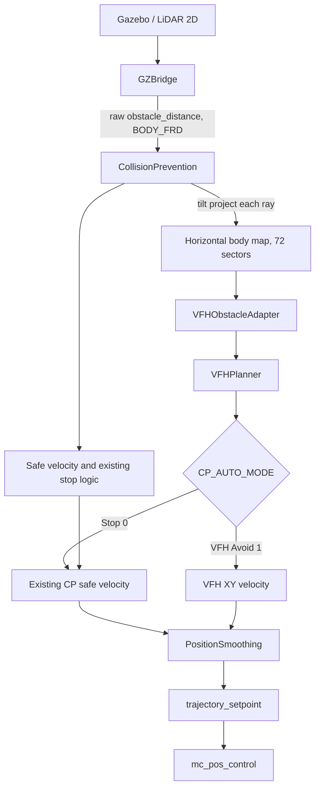
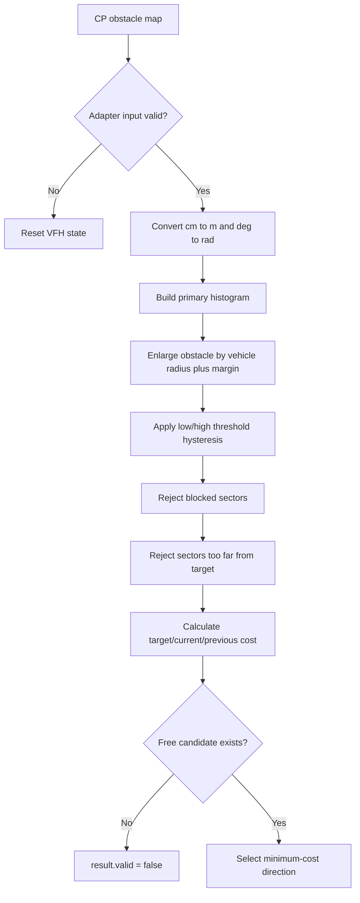

# VFH Avoidance Developer Notes

## 1. Muc dich tai lieu

Tai lieu nay la ghi chu ky thuat song cho phan tranh vat can VFH cua du an.
No duoc dat canh source de nguoi phat trien co the nhanh chong tra loi:

- Du lieu obstacle den tu dau va duoc xu ly o dau?
- Collision Prevention (CP) va VFH chia trach nhiem nhu the nao?
- He toa do, don vi va quy uoc sector la gi?
- Step nao da hoan thanh, step nao moi chi la de xuat?
- Can chay lenh nao de test, debug va xac nhan an toan?
- Can log du lieu gi de ve do thi va ban giao du an?

Bao cao tong the cua lop CP Auto nam tai:
`docs/collision_prevention_safety_layer_report.md`.

Guide ban giao tong hop source, flow, code excerpts, test va backlog nam tai:
`docs/CP_VFH_PROJECT_GUIDE.md`.

## 2. Muc tieu va gioi han

Muc tieu cua du an la tranh vat can tinh cho multicopter dan dung va nong
nghiep, uu tien an toan va kha nang dung lai khi khong chac chan.

Pham vi VFH hien tai:

- Dung LiDAR 2D 360 do.
- Dung obstacle map 72 sector, moi sector 5 do.
- Chon huong cuc bo gan huong waypoint.
- Cho phep dung lai khi khong co duong an toan, gap chu U hoac khe qua hep.
- Khong thay the Navigator, Mission, PositionSmoothing hoac controller PX4.
- Khong mapping, SLAM, global replanning hay nhan dang vat the dong.

## 3. Kien truc hien tai



Nguyen tac kien truc:

1. CP la noi duy nhat so huu viec nhan, hop nhat, xoay va kiem tra stale data.
2. VFH doc obstacle map da xu ly cua CP qua getter chi doc.
3. Adapter chi doi format, don vi va kiem tra hop le.
4. Planner chi chon huong; no khong publish mode va khong sua setpoint.
5. `CP_AUTO_MODE=0` giu nguyen Stop. `CP_AUTO_MODE=1` cho phep VFH ghi de
   XY velocity khi co sector an toan; data mat van uu tien Stop/Hold cua CP.
6. Lidar `obstacle_distance` duoc hieu chinh roll/pitch truoc khi gan vao
   map. Yaw chi duoc dung mot lan de doi map body sang local NED trong VFH.
7. Neu quaternion khong hop le, CP chi giu cac sentinel `0` va
   `max_distance + 1` theo goc BODY_FRD tho; reading trong tam bi bo qua vi
   khong the tinh khoang cach ngang tin cay.
8. Neu nhieu tia sau projection cung phu mot bin, CP gop truoc va giu reading
   gan nhat trong cung message, tranh clear reading ghi de vat can gan.

Khong tao them subscription `obstacle_distance_fused` trong `FlightTaskAuto`.
Viec doc truc tiep map cua CP tranh copy message va tranh tre mot chu ky uORB.

## 4. Ban do source

| File | Trach nhiem |
| --- | --- |
| `VFHPlanner.hpp` | Dinh nghia config, input, result va state cua planner |
| `VFHPlanner.cpp` | Tao histogram, hysteresis, mo rong obstacle va chon huong |
| `VFHObstacleAdapter.hpp` | Giao dien chuyen obstacle map CP sang input VFH |
| `VFHObstacleAdapter.cpp` | Kiem tra frame/timestamp/resolution va doi don vi |
| `VFHPlannerTest.cpp` | Unit test thuat toan va tinh huong |
| `VFHObstacleAdapterTest.cpp` | Unit test bien message va fail-safe input |
| `VFHArchitectureTest.cpp` | Test freshness architecture va benchmark planner |
| `VFHControlPolicy.*` | Policy Stop/VFH, hysteresis va no-path hard stop |
| `../collision_prevention/ObstacleMath.*` | Chieu ray lidar theo attitude va tinh bearing ngang |
| `CMakeLists.txt` | Build library va dang ky unit test |
| `../collision_prevention/CollisionPrevention.*` | So huu obstacle map va safe velocity |
| `../../modules/flight_mode_manager/tasks/Auto/FlightTaskAuto.*` | Goi CP, chon Stop/VFH va xu ly Auto |
| `../../modules/simulation/gz_bridge/GZBridge.cpp` | Gom scan LiDAR thanh 72 sector |

## 5. Quy uoc du lieu

### 5.1 ObstacleDistance cua PX4

- `distances[72]`: centimet.
- `increment`: degree, hien tai bat buoc gan 5 do.
- `angle_offset`: degree cua tam sector dau tien.
- `frame`: VFH chi nhan `MAV_FRAME_BODY_FRD`.
- `UINT16_MAX`: unknown/not observed.
- `max_distance + 1`: da quan sat va khong co obstacle trong tam sensor.
- `0`: da quan sat nhung obstacle gan hon minimum range; phai xem la nguy hiem.
- Voi `MAV_FRAME_BODY_FRD`, range lidar raw duoc chieu theo roll/pitch truoc khi
  gan vao obstacle map. Gia tri `0`, `UINT16_MAX` va `max_distance + 1` duoc
  giu nguyen semantics; khong duoc nhan chung voi he so cos(roll/pitch).

### 5.2 VFHPlanner

- Khoang cach: meter.
- Goc: radian.
- Goc duoc wrap trong `[-pi, pi]`.
- Obstacle map dau vao la BODY_FRD: X tien, Y phai, Z xuong.
- Adapter xoay geometry sang local NED truoc khi planner tinh histogram de
  hysteresis va previous direction khong bi sai khi UAV doi yaw.
- Goc planner trong local NED: X North, Y East; goc duong tang ve East.

Chuyen huong local NED sang body FRD:

```text
direction_local = atan2(East, North)
direction_body  = wrap_pi(direction_local - vehicle_yaw)
```

Vi du waypoint local 80 do va yaw UAV 30 do thi waypoint nam o 50 do ben
phai than UAV.

## 6. Flow thuat toan



Cost hien tai:

```text
J = target_weight   * angle_error(candidate, target)
  + current_weight  * angle_error(candidate, current_motion)
  + previous_weight * angle_error(candidate, previous_selection)
```

Sector co cost thap nhat duoc chon. Sector blocked khong duoc tinh cost.

## 7. Cac bat bien an toan

Cac quy tac sau khong duoc pha khi nang cap:

- Unknown data khong duoc coi la free space.
- Zero distance khong duoc coi la free space.
- Khong co candidate an toan phai tra `result.valid = false`.
- VFH khong duoc chon huong vuot `max_target_direction_change`.
- Mat sensor phai de CP hien tai ep dung va request Hold theo logic da chot.
- RTL van duoc loai khoi CP Auto cho den khi co quyet dinh moi duoc test.
- Planner state phai reset khi CP tat, data mat, task doi hoac khong co target.
- Khong sua truc tiep motor, attitude, rate hay control allocation.

## 8. Trang thai cac step

| Step | Noi dung | Trang thai |
| --- | --- | --- |
| CP safety layer | Safe velocity, braking, sensor-loss stop/Hold, RTL guard | Da co trong source; regression test pass |
| VFH Step 1 | Pure `VFHPlanner` va unit test | Hoan thanh |
| VFH Step 2 | Adapter CP map, LiDAR min aggregation va unit test | Hoan thanh |
| VFH Step 3 | Doc CP map va chay VFH trong `FlightTaskAuto` | Hoan thanh |
| VFH Step 4 | Dung selected direction de tao velocity direction moi | Da merge vao source chinh; VFH 6/6 va regression 10/10 pass |
| VFH Step 5 | Phoi hop VFH direction, CP safe speed va no-path stop | Da merge vao source chinh; policy va regression pass |
| VFH Step 6 | SITL scenario matrix va tuning | Them world `vfh_obstacle_course`, gioi han VFH 3 m/s va bo phan tich ULog HTML |
| VFH Step 7 | Hardware flight test theo tung cap toc do | Chua trien khai |

## 9. Debug hien tai

Build va test:

```sh
make tests TESTFILTER=VFH
make tests TESTFILTER=CollisionPrevention
```

Chay SITL:

```sh
make px4_sitl gz_x500_lidar_2d
```

Chay world obstacle course:

```sh
make px4_sitl gz_x500_lidar_2d_vfh_obstacle_course
```

Neu can dat UAV o dau course theo toa do trong world:

```sh
PX4_GZ_MODEL_POSE=-10,0,2.5,0,0,0 \
  make px4_sitl gz_x500_lidar_2d_vfh_obstacle_course
```

Tham so test co ban:

```text
CP_DIST=1.5
CP_AUTO_EN=1
CP_AUTO_DIST=6.0      # bat dau giam toc som de du thoi gian phanh
CP_AUTO_MODE=1       # VFH Avoid
CP_VFH_MAX_VEL=3.0   # gioi han toc do VFH
CP_VFH_STOP_DIST=1.5 # dung khan cap theo corridor VFH
MPC_XY_CRUISE=1.0    # dung 1.0 m/s cho lan SITL dau
```

`CP_DIST` van la khoang cach toi thieu cho Collision Prevention trong Manual.
`CP_AUTO_DIST` la khoang cach toi thieu duoc dung trong nhanh safe-velocity cua
Auto; source hien tai mac dinh 6.0 m va khong thay doi CP_DIST.

`CP_VFH_MAX_VEL` la can tren rieng cua VFH. Toc do thuc te van la gia tri nho
nhat giua toc do mission, `MPC_XY_VEL_MAX` va `CP_VFH_MAX_VEL`. Stop mode
(`CP_AUTO_MODE=0`) khong dung tham so nay va giu nguyen safe-velocity braking.

Trong Auto, `CP_AUTO_DIST` la moc de bat dau giam toc va la khoang cach dung
trong stopping envelope cu cua CP. Khi VFH Avoid dang bat, toc do moi duoc
tinh theo corridor ma VFH da chon, khong lay vat can gan nhat tren toan bo
360 do. `CP_VFH_STOP_DIST` la nguong dung khan cap rieng: neu khoang cach
chieu tren corridor <= 1.5 m, VFH khong tiep tuc gui velocity va Auto ep
van toc XY bang 0. Neu corridor van hop le nhung gan, toc do giam dan truoc
nguong nay. Neu planner khong co path, Auto van dung theo no-path policy va
khong tu dong goi Position.

Kiem tra input:

```sh
listener obstacle_distance 1
listener obstacle_distance_fused 1
```

VFH control log duoc gioi han mot lan moi giay:

```text
VFH control: path=1 avoid=1 velocity=1 target=0.0 selected=35.0 free=42
```

Y nghia:

- `path`: planner co tim duoc candidate an toan hay khong.
- `avoid`: sector huong target co dang blocked hay khong.
- `target`: huong waypoint trong local NED, degree.
- `selected`: huong planner da chon trong local NED, degree.
- `free`: so candidate con lai sau blocked va angle limit.

Log chi xuat hien khi CP Auto active, `CP_AUTO_MODE=1`, waypoint type phu hop, khong RTL,
co obstacle data va co travel direction lon hon 0.1.

## 10. Ma tran SITL cho Step 4

| Scenario | Ket qua mong doi | Ket qua gan nhat |
| --- | --- | --- |
| Khong co obstacle | `path=1`, `avoid=0`, selected gan target | Pass SITL 2026-09-08 |
| Obstacle truoc mat | `path=1`, `avoid=1`, selected lech trai hoac phai | Pass SITL 2026-09-08 |
| Obstacle ben trai, target phia truoc | selected van gan target neu forward sector free | Chua chay SITL |
| Obstacle ben phai, target phia truoc | selected van gan target neu forward sector free | Chua chay SITL |
| Khe rong | selected nam gan tam vung free | Chua chay SITL |
| Khe hep hon protected diameter | `path=0` | Unit test pass; chua chay SITL |
| Chu U, chi phia sau free | `path=0` voi angle limit hien tai | Unit test pass; chua chay SITL |
| Tat LiDAR khi dang Mission | CP dung va chuyen Hold sau 1 s; VFH state reset | Pass SITL 2026-09-08 |
| Co chuyen lai Mission khi LiDAR van tat | CP tiep tuc chan va chuyen lai Hold | Pass SITL 2026-09-08 |
| Bat lai LiDAR | Topic cap nhat lai va canh bao dung | Pass SITL 2026-09-08 |
| Quay yaw UAV tai cho | Target/selected cung o local NED, khong dao dong do doi yaw | Chua chay SITL |

Moi scenario can ghi lai parameter, toc do, vi tri obstacle, VFH control log va ket
qua thuc te truoc khi danh dau Step 4 la da xac nhan.

### 10.1 Lan xac nhan 2026-09-08

Automated tests:

- `make tests TESTFILTER=VFH`: 5/5 test pass (`VFHPlanner`,
  `VFHArchitecture`, `VFHObstacleAdapter`, `VFHVelocitySetpoint`,
  `VFHControlPolicy`).
- Regression group gom `CollisionPrevention`, `ObstacleMath`,
  `VelocitySmoothing`, `PositionSmoothing` va nam test VFH: 9/9 pass.

SITL setup:

- Model: `gz_x500_lidar_2d`.
- `CP_AUTO_EN=1`, `CP_DIST=2.0 m`, `MPC_XY_CRUISE=1.0 m/s`.
- Raw `obstacle_distance`: 72 sector, increment 5 do, offset -180 do,
  `MAV_FRAME_BODY_FRD`. BODY_FRD input must cover one full revolution with an
  integer number of sectors and cannot exceed the 72-element uORB array.
- CP `obstacle_distance_fused`: 72 sector, increment 5 do, offset 0 do,
  `MAV_FRAME_BODY_FRD`.

Ket qua flight:

- Mission duong trong 35 m: `path=1`, `avoid=0`; selected bam target voi sai
  so luong tu toi da mot sector 5 do.
- Box tinh 2 x 2 x 6 m dat giua duong bay: VFH doi sang `avoid=1`, selected
  lech khoi huong waypoint, sau do quay lai duong bay va den mission item 2.
- Box rong 8 x 2 x 6 m: Stop mode dung truoc obstacle; VFH Avoid mode ne mot
  phia, khong dao dong doi phia.
- Khi VFH da active nhung khong con sector an toan qua 500 ms, policy phat
  `no_path_event` mot lan va giu zero XY velocity. Khi corridor hop le xuat hien
  lai, latch no-path duoc xoa va VFH co the tiep tuc; `reset()` van xoa toan bo
  state khi doi mode hoac mat du lieu sensor.
- Khi `SIM_GZ_LIDAR_F=1`, timestamp raw topic ngung tang, warning
  `distance sensor data lost` xuat hien khoang 1 Hz va mode doi Mission sang
  Hold sau nguong 1 s.
- Khi operator co chuyen lai Mission trong luc LiDAR van mat, mode lai ve Hold.
  Bai test nay duoc chay khi heartbeat GCS van con de khong lan voi datalink
  failsafe.
- Khi `SIM_GZ_LIDAR_F=0`, raw topic cap nhat lai voi age khoang 20 ms va warning
  dung. Mode van giu Hold; he thong khong tu dong tiep tuc mission.
- ULog cua flight co obstacle: `log/2026-09-08/01_48_15.ulg` trong SITL rootfs.

### 10.2 Step 4 merged integration

- `CP_AUTO_MODE=0`: box rong 8 x 2 x 6 m lam UAV dung truoc vat can bang CP
  hien tai, khong doi phia va khong tu dong doi mode Mission.
- `CP_AUTO_MODE=1`: box nho 2 x 2 x 6 m duoc ne, UAV quay lai duong waypoint
  va den mission item 2.
- Box rong 8 x 2 x 6 m duoc ne ve mot phia voi do lech ngang lon nhat khoang
  5.3 m, khong dao dong doi phia.
- Dropout `SIM_GZ_LIDAR_F` khoang 250 ms khong phat warning, khong Hold, va
  mission tiep tuc. Dropout khoang 550 ms phat warning nhung phuc hoi truoc
  nguong Hold 1 s.
- Test `no free sector`, obstacle rong, short dropout va body-to-local frame
  da duoc them vao unit test/adapter test.

### 10.3 World obstacle course

File `Tools/simulation/gz/worlds/vfh_obstacle_course.sdf` dung model
`gz_x500_lidar_2d` va sap xep vat can theo truc bay +X:

| Khu vuc | Toa do x gan dung | Muc dich |
| --- | ---: | --- |
| Single block | 8.5-11.5 m | Chon trai/phai co ban |
| Wide wall | 31.5-39.5 m | Vung blocked rong |
| L wall | 59.0-69.75 m | Kiem tra corner va quay lai line |
| Tall columns | 89.75-99.95 m | Kiem tra nhieu cot cao |
| Narrow gate | 119.95-122.95 m | Khe rong 4 m, kiem tra corridor |
| Central tower | 142.95-145.95 m | Vat can cao o giua huong bay |
| U dead end | 165.95-174.45 m | Scenario cuoi, kiem tra no-free-sector va dung an toan |

Nen bay tung waypoint ket thuc sau mot khu vuc. Khong nen cho UAV bay qua
toan bo course trong lan test dau vi cac vat can duoc dat lien tiep tren cung
mot line.

### 10.4 Xac nhan tilt compensation 2026-09-10

- `make tests TESTFILTER=CollisionPrevention`: 31/31 test pass.
- Regression `CollisionPrevention`, `ObstacleMath`, smoothing va toan bo VFH:
  10/10 test pass.
- `CCACHE_DISABLE=1 make px4_sitl`: build va link `bin/px4` pass.
- Test moi bao gom yaw cancellation, roll/pitch range projection, remap tia
  diagonal, overlap qua bien 0/360, merge gan nhat, sentinel khi attitude loi
  va tu choi resolution vuot qua 72 phan tu.
- Chua thay the duoc hardware flight test; can xac nhan bang ULog rang
  `obstacle_distance` raw va `obstacle_distance_fused` phu hop voi roll/pitch.

## 15. Step 4 code change log

Line numbers below refer to the merged source tree after this step. The code was
copied from the tested Step 4 workspace and reviewed against the existing PX4
Auto task before merge.

| File and lines | Change | Tac dung |
| --- | --- | --- |
| `src/lib/collision_prevention/collisionprevention_params.c:96-108` | Them `CP_AUTO_MODE` | `0` giu Stop; `1` cho phep VFH Avoid; gia tri la khac mac dinh ve Stop |
| `src/lib/collision_prevention/collisionprevention_params.c:110-122` | Them `CP_VFH_MAX_VEL` default 3.0 m/s | Gioi han toc do ngang do VFH tao ra, van ton trong mission speed va `MPC_XY_VEL_MAX` |
| `src/lib/collision_prevention/collisionprevention_params.c:136-149` | Them `CP_VFH_STOP_DIST` default 1.5 m | Nguong emergency stop theo khoang cach chieu tren corridor VFH |
| `src/modules/flight_mode_manager/tasks/Auto/CMakeLists.txt:38-40` | Link `VFHPlanner` vao Auto task | Da co tu buoc truoc; duoc giu nguyen de Auto dung VFH library |
| `src/lib/CMakeLists.txt:82-84` | Add subdirectory `vfh_avoidance` | Da co tu buoc truoc; khong thay doi them trong Step 4 |
| `src/lib/collision_prevention/CollisionPrevention.hpp:87-91` | Getter obstacle map va sensor delay | VFH dung cung obstacle map va `CP_DELAY`, khong tao delay rieng |
| `src/modules/flight_mode_manager/tasks/Auto/FlightTaskAuto.hpp:57-61` | Include policy va velocity adapter | Cho Auto task goi cac lop Step 4 |
| `FlightTaskAuto.hpp:98-101` | Them enum Stop/VFH | Tranh dung magic number va giu mapping voi policy |
| `FlightTaskAuto.hpp:131-134` | Them output override, `_updateVFH`, `_resetVFH` | Tach ro VFH control path va reset state |
| `FlightTaskAuto.hpp:174-176,209` | Them state VFH va param handle | Luu hysteresis/log va doc `CP_AUTO_MODE` |
| `FlightTaskAuto.cpp:83-90` | Reset policy va planner khi activate | Khong ke thua huong/blocked history tu task truoc |
| `FlightTaskAuto.cpp:180-194` | Xu ly `vfh_velocity_override`, xoa XY waypoint | Khong cho waypoint feed-forward cong them vao velocity VFH |
| `FlightTaskAuto.cpp:871-931` | Tich hop Stop mode, sensor-loss va reset VFH | Mat data van brake/hold theo CP hien tai |
| `FlightTaskAuto.cpp:936-952` | Dung `_triplet_target - _position` | VFH nham toi waypoint Navigator, khong nham diem off-track noi bo |
| `FlightTaskAuto.cpp:954-1008` | Goi `VFHControlPolicy` va emergency stop | Chon Stop/VFH, no-path timeout va hard stop 1.5 m |
| `FlightTaskAuto.cpp:984-1045` | Giu CP safe-velocity fallback va apply VFH override | Co duong thi ne; khong co duong thi stop; Stop mode khong doi behavior cu |
| `FlightTaskAuto.cpp:1047-1145` | Them `_updateVFH`, speed limit theo corridor va emergency stop | Adapter -> planner -> directional speed -> velocity setpoint; log speed/clearance 1 Hz |
| `FlightTaskAuto.cpp:984-1004` | Gioi han ca VFH feed-forward va PositionSmoothing | Setpoint va trajectory deu dung cung can tren `CP_VFH_MAX_VEL` |
| `FlightTaskAuto.cpp:1118-1157` | Tinh speed theo corridor da chon | Vat can ngoai corridor khong lam giam toc; vat can tren corridor lam giam toc; 1.5 m yeu cau dung |
| `VFHObstacleAdapter.hpp/.cpp:16-55` | Them `frame_rotation`, xoay BODY_FRD sang local NED | Obstacle, waypoint va current velocity dung cung frame |
| `VFHVelocitySetpoint.hpp/.cpp:13-26` | Them chuyen selected angle thanh XY velocity | Tao vector `cos/sin * speed`, tu choi input loi |
| `VFHDirectionalSpeedLimiter.hpp/.cpp` | Them tinh clearance chieu va toc do an toan | Dung `CP_DELAY`, brake acceleration, `CP_AUTO_DIST` va `CP_VFH_STOP_DIST` |
| `src/lib/collision_prevention/ObstacleMath.hpp/.cpp` | Them `project_ray_on_horizontal_plane()` | Dung quaternion attitude de tinh khoang cach ngang va bearing body-horizontal cho tung tia |
| `src/lib/collision_prevention/CollisionPrevention.hpp:139-140` | Truyen them vehicle attitude vao map merger | Cho nhanh `obstacle_distance` dung roll/pitch khi xu ly lidar |
| `src/lib/collision_prevention/CollisionPrevention.cpp:376-521` | Validate resolution, dong bo timestamp, chieu tia va merge bao thu truoc khi ghi map | Tranh doc vuot 72 phan tu, tranh dung attitude lech thoi gian, giu phu sector qua 0/360 va giu vat can gan nhat |
| `src/lib/collision_prevention/CollisionPreventionTest.cpp:1075-1185` | Test tilt, yaw cancellation, sector boundary, sentinel, merge va resolution | Kiem tra pitch/roll lam doi range, yaw khong lam doi body sector, sentinel khong mat va logic cu khong regression |
| `VFHControlPolicy.hpp/.cpp:11-69` | Them state machine Stop/VFH | VFH active, clear hysteresis 1 s, no-path stop 500 ms |
| `src/lib/vfh_avoidance/CMakeLists.txt:7-22` | Build source va test moi | Dang ky directional speed limiter va unit test |
| `src/lib/vfh_avoidance/VFHDirectionalSpeedLimiter.cpp:78-99` | Khong ep minimum speed khi delay da tieu het khoang phanh | VFH gui zero thay vi 0.1 m/s khi khong con braking distance |
| `VFHPlannerTest.cpp:65-105` | Test obstacle rong va no-free-sector | Kiem tra chon mot phia va fail-safe |
| `VFHObstacleAdapterTest.cpp:59-119` | Test frame rotation va dropout ngan | Kiem tra doi frame va phuc hoi data moi |
| `VFHVelocitySetpointTest.cpp:14-62` | Test huong, toc do va input invalid | Kiem tra vector velocity dau ra |
| `VFHControlPolicyTest.cpp:22-106` | Test Stop/VFH/no-path/clear/reset | Kiem tra state machine va hysteresis |
| `VFHDirectionalSpeedLimiterTest.cpp` | Test corridor speed va emergency stop | 10 case: phia truoc, ben trai, phia phai, chu L, no-data, 1.5 m, 0.79 m, input loi va delay het khoang phanh |

`VFHPlanner.cpp` khong doi logic trong Step 4; Step 4 chi bo sung test cho
obstacle rong va truong hop tat ca sector bi occupied.

| `Tools/simulation/gz/worlds/vfh_obstacle_course.sdf` | World test block, wall, U, L, cot cao va khe hep | Tao cung mot bo vat can lap lai duoc cho SITL |
| `Tools/vfh_avoidance/analyze_vfh_ulog.py` | Doc ULog va sinh HTML tu chua | Ve trajectory, speed, clearance, setpoint, CP constraint, attitude va events |

### 15.1 Runtime flow after merge

```text
FlightTaskAuto::update()
  -> _updateCollisionPreventionConstraints()
  -> CP_AUTO_EN / sensor / RTL guard
  -> _updateVFH() when CP_AUTO_MODE=1
  -> VFHObstacleAdapter (BODY_FRD -> local NED)
  -> VFHPlanner (blocked sectors -> selected direction)
  -> VFHDirectionalSpeedLimiter (corridor clearance -> speed or emergency stop)
  -> VFHVelocitySetpoint (direction -> XY velocity)
  -> PositionSmoothing
  -> trajectory_setpoint
  -> mc_pos_control
```

`Navigator` van la chu the quan ly `current_seq` va dieu kien waypoint reach.
VFH chi thay doi velocity tam thoi; no khong tu them, xoa hoac skip waypoint.

### 15.2 Vi sao UAV tro ve line sau khi het vat can

Flow hien tai la:

1. `FlightTaskAuto::_updateVFH()` dung `_triplet_target - _position` de huong
   toi waypoint hien tai cua Navigator.
2. Khi target sector bi blocked hoac safe-velocity bao nguy co phanh,
   `VFHControlPolicy` bat `vfh_velocity_override` va `FlightTaskAuto` gui
   velocity sang corridor an toan.
3. Khi nguy co het lien tuc qua hysteresis 1 s, policy tat override.
4. Neu VFH khong co path, Auto dung tai cho bang setpoint XY bang 0 trong khi
   cho sensor/path phuc hoi; khong chuyen sang Position tu dong.
5. `FlightTaskAuto` tiep tuc dung trajectory setpoint cua waypoint hien tai,
   nen `PositionSmoothing` tu nhien keo UAV ve line waypoint roi bay tiep.

Vi VFH khong cap nhat `current_seq` va khong chen waypoint, UAV se quay ve line
cua waypoint dang bay toi. Neu UAV da vuot dieu kien reach cua waypoint, chinh
`Navigator` moi tang `current_seq` sang waypoint tiep theo; VFH khong tu quyet
dinh viec nay.

### 15.3 Test commands

Run unit tests for the VFH library:

```bash
cd /home/nhut/PX4-Autopilot
make tests TESTFILTER=VFH
```

Run the focused regression group:

```bash
ctest --test-dir build/px4_sitl_test --output-on-failure \
  -R 'VFH|CollisionPrevention|ObstacleMath|VelocitySmoothing|PositionSmoothing'
```

Expected test names after Step 4:

```text
unit-VFHPlanner
unit-VFHArchitecture
unit-VFHObstacleAdapter
unit-VFHVelocitySetpoint
unit-VFHDirectionalSpeedLimiter
unit-VFHControlPolicy
functional-CollisionPrevention
unit-ObstacleMath
unit-VelocitySmoothing
unit-PositionSmoothing
```

For SITL, build and launch the lidar model, then set:

```text
CP_AUTO_EN=1
CP_AUTO_MODE=0   # Stop
CP_AUTO_MODE=1   # VFH Avoid
CP_VFH_STOP_DIST=1.5
```

Compare the two modes with the same mission and obstacle. Save the ULog and
check `VFH control`, `distance sensor data lost`, mission sequence and XY
position before changing tuning parameters.

### 15.4 Lidar tilt compensation

`GZBridge::laserScanCallback()` phat raw range tu LaserScan voi frame
`MAV_FRAME_BODY_FRD`. Khi UAV level, khoang cach va bearing giu nguyen. Khi
UAV roll/pitch, `CollisionPrevention::_addObstacleSensorData()` xu ly tung
sector nhu sau:

```text
ray_body = [cos(angle), sin(angle), 0]
ray_ned  = q_world_vehicle * ray_body
scale    = norm(ray_ned.xy)
range_h  = range * scale
angle_h_body = wrap_pi(atan2(ray_ned.y, ray_ned.x) - vehicle_yaw)
```

`angle_h_body` duoc dung de tim cac map bin giao voi sector lidar. Scale bao
thu duoc lay nho nhat giua ray trung tam va hai bien sector, sau do dung de
khong danh gia cao khoang cach khi sector bi nghiêng. Hai bien sector cung
duoc dung de giu phu chong bin, ke ca khi interval vuot qua 0/360 do.
`VFHObstacleAdapter` van them yaw mot lan khi doi map body-horizontal sang
local NED.

Gia dinh cua implementation:

- Lidar 2D co mat quet nam ngang voi BODY_FRD khi UAV level.
- `obstacle_distance` chua raw slant range, chua duoc sensor tu chieu ngang.
- Attitude quaternion mo ta phep quay BODY_FRD sang NED va hop le.
- CP chi dung bu tilt khi timestamp attitude gan timestamp lidar trong 100 ms.
  Neu khong, range trong tam bi bo qua; sentinel `0` va `max_distance + 1`
  van duoc map theo goc BODY_FRD de giu fail-safe.
- Hieu chinh nay chua mo hinh hoa day du do lech vi tri sensor hoac vat can
  co hinh hoc phuc tap theo truc Z.

Neu mot hardware lidar da tu bu tilt truoc khi publish `obstacle_distance`,
khong duoc bat them mot lop bu tuong tu vi se thanh double compensation.

### Khoang trong can theo doi truoc hardware flight

- VFH adapter van cho phep map co tuoi toi da 500 ms, trong khi directional
  speed limiter moi tru CP delay va chua cong tuoi rieng cua tung sector vao
  braking envelope.
- Config VFH can duoc bo sung kiem tra `isfinite` cho tat ca weight va radius
  truoc khi dung `ceilf` trong histogram.
- Cac diem tren la residual risk cua VFH, khong phai loi cua phep chieu tilt;
  can xu ly truoc khi danh gia an toan o toc do cao.

## 11. Log va ve do thi

Sau moi flight, luu file `.ulg` va chay:

```sh
cd /home/nhut/PX4-Autopilot
python3 Tools/vfh_avoidance/analyze_vfh_ulog.py \
  /path/to/flight.ulg \
  --output /path/to/flight.vfh.html
```

Mo `flight.vfh.html` bang trinh duyet. Script khong can Plotly hay internet,
chi can package `pyulog` va `numpy`.

Du lieu nen xem truoc:

- `vehicle_local_position`: trajectory XY, toc do XY, do cao.
- `vehicle_local_position_setpoint`: line/waypoint va velocity setpoint.
- `obstacle_distance_fused`: khoang cach vat can nho nhat va max range.
- `collision_constraints`: original/adapted XY constraint cua CP.
- `vehicle_attitude`: roll, pitch, yaw de kiem tra nghieng va frame.
- `vehicle_status` va `position_setpoint_triplet`: mode transition va current
  mission sequence neu logger co ghi.

Script dung `ulog.start_timestamp` de canh moc thoi gian. Clearance duoc tinh
tu gia tri nho nhat cua 72 phan tu `distances[]`; truong `min_distance` cua
message chi la gioi han gan nhat cua sensor, khong phai khoang cach vat can.

HTML tu dong danh dau:

- toc do thuc te vuot `CP_VFH_MAX_VEL` hon 5%;
- khoang cach nho hon `CP_DIST`;
- gap obstacle data qua 0.7 s;
- roll/pitch vuot 125% `CP_MAX_ANGLE`;
- cac topic khong co trong ULog.

`PX4_INFO` phu hop cho debug nhanh nhung khong phu hop lam nguon do thi chinh
thuc. `VFH control` hien van chi duoc in text, nen HTML chua ve duoc
`selected_direction`, `cost` va `free_sector_count` theo tung mau. Can them
mot uORB debug status message neu muon phan tich planner day du:

```text
timestamp
input_valid
path_valid
avoidance_required
target_direction
current_direction
selected_direction
cost
free_sector_count
closest_distance
safe_velocity
```

Sau khi message va logging profile duoc phe duyet, ULog co the dung de ve:

- Target direction va selected direction theo thoi gian.
- Obstacle distance va safe velocity.
- Free-sector count khi UAV vao khe hep.
- Planner runtime va chu ky cap nhat.
- Trang thai sensor-valid, braking, no-path va mode transition.

Cong cu hien tai la `Tools/vfh_avoidance/analyze_vfh_ulog.py`; PX4 Flight Review
van huu ich de kiem tra tong quat, con HTML nay tap trung vao CP/VFH.

## 12. Quy trinh cap nhat tai lieu

Sau moi step duoc nguoi phat trien chot:

1. Cap nhat bang trang thai step va ngay xac nhan.
2. Cap nhat flow neu data/control path thay doi.
3. Ghi ro file, parameter va uORB topic moi.
4. Ghi lenh test da chay va ket qua.
5. Ghi scenario SITL/hardware da xac nhan.
6. Ghi quyet dinh an toan va ly do, khong chi ghi code da sua.
7. Liet ke van de con mo va dieu kien de sang step tiep theo.

Tai lieu chi danh dau `Hoan thanh` khi code, automated test va muc validation
duoc yeu cau cua step deu da dat. Code compile thanh cong khong tu dong co nghia
la hanh vi bay da duoc xac nhan.

## 13. Checklist ban giao

- [ ] Branch/commit va PX4 base version duoc ghi lai.
- [ ] Tat ca parameter CP/VFH co default, unit va range ro rang.
- [ ] Tat ca uORB input/output va frame duoc tai lieu hoa.
- [ ] Unit test va regression test pass.
- [ ] SITL scenario matrix co bang ket qua.
- [ ] ULog mau va script/huong dan ve do thi duoc kem theo.
- [ ] Sensor-loss, no-path, narrow-gap va U-shape duoc xac nhan.
- [ ] Gioi han phan cung va tan so LiDAR duoc ghi lai.
- [ ] Hardware test tang dan toc do, co khu vuc va phuong an an toan.
- [ ] Known limitations va backlog duoc cap nhat.

## 14. Lich su tai lieu

| Ngay | Thay doi |
| --- | --- |
| 2026-09-07 | Tao README; ghi lai kien truc CP/VFH, Step 1-3, debug, plotting va handoff flow |
| 2026-09-08 | Merge Step 4-5 vao source chinh; them code change log, flow va lenh test |
| 2026-09-09 | Them `CP_VFH_MAX_VEL`, world obstacle course va script phan tich ULog HTML |
| 2026-09-09 | Them directional speed theo corridor va `CP_VFH_STOP_DIST=1.5 m`; unit test 6/6 VFH pass |
| 2026-09-10 | Them tilt projection cho raw lidar `obstacle_distance`, giu sector overlap; `CollisionPrevention` 30/30, `ObstacleMath` pass va build SITL pass |
